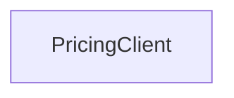

# Diagramming rules

Authoritative rules for codebase diagrams. They apply throughout analysis,
planning, and drafting — not just at review time.

## Core principles

**R1 — Separate views; never mix abstraction levels.** Keep these concerns in
separate diagrams: system context (external world), runtime architecture
(deployables/services/datastores), module decomposition (packages/bounded
contexts), static structure (types/data model), runtime behaviour
(interactions over time), algorithms (local control flow).

**R2 — One diagram = one question + one zoom level.** If it gets dense or
starts mixing concerns, split it.

**R3 — Notation must match semantics.** No "by vibe" naming:

| Notation | Use only for | Mermaid |
|---|---|---|
| UML class | Real code types (classes/interfaces) with members; evidence-based relations | `classDiagram` |
| UML sequence | One concrete scenario, time-ordered messages between evidenced actors | `sequenceDiagram` |
| ERD | Persistent entities (tables/models) with evidence-based relationships | `erDiagram` |
| Flowchart | Universal fallback: architecture, modules, processes | `flowchart` |

Misuse to avoid: no class diagrams for packages/services/deployables; no
sequence diagrams for static structure or import graphs; no ERD for in-memory
or request DTOs.

**R4 — No inventories.** A list of "key files/types" is not a diagram. Every
element must be connected by typed relationships and serve the diagram's
question. (Exception: module dependency graphs may use unlabelled edges — R9.)

**R5 — No duplication.** Each diagram adds unique value: a different question
or a different zoom. Heavy overlap → keep one.

**R6 — Truthfulness over completeness.** Anything you cannot ground in the repo
is marked `UNKNOWN/VERIFY` in the notes, not invented. Avoid precise
quantitative claims ("100+ models", "150 integrations") unless you can cite an
anchor — otherwise mark them UNKNOWN.

**R7 — Audience-fit granularity.** High-signal elements only; no exhaustive
member listings by default. Target 5-second scan comprehension.

**R8 — Edge labels must not be generic.** Banned as default labels: *uses,
contains, relates, has, supports, manages, integrates*. Use typed verbs. If you
cannot be specific, label the edge `UNKNOWN` and add an UNKNOWN/VERIFY note.

**R9 — Dependency / import graph convention.** For compile-time module
structure:
- Prefer **unlabelled** edges plus a one-line legend node, e.g.
  "Legend: → = compile-time dependency (imports)".
- Do not repeat "imports" on every edge unless it adds object-level detail
  ("imports types", "imports UI components", "imports Prisma client").
- Containment is **not** a dependency edge — express it with `subgraph`
  clusters, never with a `contains` connector.
- Do not mix runtime calls into an import graph. Runtime communication gets its
  own diagram with HTTP/gRPC/publishes/reads/writes labels.

**R9b — Draw the boundaries; `subgraph` is expected, not optional.** Wherever a
diagram has zones a reader must see — deployment/runtime boundaries, network or
trust boundaries, service vs datastore, first-party vs external, monorepo
`apps/` vs `packages/`, bounded contexts, process/host ownership — express them
with `subgraph` clusters and a title. A topology or deployment view drawn as a
flat mesh of nodes has thrown away half its information.

- Group by the boundary that answers the diagram's question, and only that one.
  Nested subgraphs are fine two deep; deeper means you are mixing zoom levels
  (R2).
- Subgraphs are free (see the split check) and are the *only* correct way to
  show containment — never a `contains` edge (R9).
- A Miro section/frame is not a substitute: it frames a whole diagram, not
  zones inside one (see the note in SKILL.md step 5).

**R10 — Never put a repo path in a node; link to GitHub instead.** Node labels
carry *concepts* — `Checkout Service`, `PricingClient`, `order.created` — not
`src/checkout/service/pricing_client.ts`. Paths are noise at scan distance, they
bloat node width, and they go stale silently.

Traceability belongs on the node as a **clickable GitHub link**:

- **Link target.** Commit-pinned permalink:
  `https://github.com/<owner>/<repo>/blob/<sha>/<path>`, plus `#L<start>-L<end>`
  when a specific symbol is the anchor. Directory nodes link to
  `/tree/<sha>/<path>`. Never link a branch name — it rots.
- **Tooltip.** The second string is where the path may appear — it is the
  hover affordance, not the label.
- **Notation support.** `click` works in `flowchart` and `classDiagram`
  (`click <Class> href "<url>" "<tooltip>"`). Mermaid 10.3 has no click binding
  for `sequenceDiagram` or `erDiagram` — for those, anchors live in the
  companion doc only. Still no paths in participant/entity names.
- **Coverage, not saturation.** Link the nodes a reader would actually want to
  jump into (typically 3–8 per diagram). A node grounded in many files gets the
  one entry point that best explains it, or no link at all.
- **No GitHub remote** (`git remote get-url origin` is not github.com, or
  absent): omit links entirely and keep anchors in the companion doc. Do not
  fall back to writing paths into labels.

## Practical heuristics

**H2 — Anti-patterns (split these).** Never combine in one diagram:
- user/product flow + internal method-level calls
- runtime deployables/datastores + class internals
- module decomposition + function-level control flow
- static type structure + temporal behaviour

**H3 — Edge label palette.** Pick the most precise verb you can justify:
- compile-time: unlabelled (preferred, with legend), "imports types", "imports runtime module", "build-time depends on"
- calls: `calls`, `invokes`
- API: `HTTP`, `REST`, `gRPC`, `API call`
- async: `publishes`, `subscribes`, `enqueues`, `dequeues`
- data: `reads`, `writes`, `queries`, `persists`
- lifecycle: `configures`, `initializes`, `mounts`

Avoid bare "depends on" — qualify it or drop the label. Ungroundable
relationship → `UNKNOWN` + a note.

**H4 — Lightweight traceability.** Anchors (file/module/symbol) are for human
navigation. Surface them two ways, never as label text (R10):
1. On the node, as a `click` link to a commit-pinned GitHub permalink.
2. In the companion doc, 1–3 per diagram — the only channel for `erDiagram` and
   `sequenceDiagram`, and the place a reader scans without opening the board.

Do not turn diagram production into repo validation: an anchor you can't
confirm is an UNKNOWN/VERIFY note, not a guessed link. A wrong link is worse
than no link.

## Pre-flight checks (run before publishing)

- **Split check.** Count nodes/classes/entities/actors per diagram. Over ~15 →
  split into "Overview" + "Deep dive". Over ~20 → you must split.
  **`subgraph` wrappers and legend nodes do not count toward the budget.** They
  cost no reading effort — they reduce it. Never drop a boundary to get under
  the limit; if a diagram is over, remove or split *content*.
- **Edge label check.** Scan for banned generic verbs; replace with H3 verbs or
  `UNKNOWN` + note.
- **Import-graph check (R9).** Many repeated "imports" edges → strip to
  unlabelled + legend. No `contains` connectors — use `subgraph`.
- **ERD check.** Many non-key fields per entity → reduce to PK/FK/UQ plus 2–4
  distinguishing fields, and note the omission. Full schema only on request, as
  a separate "ERD Deep Dive".
- **Boundary check (R9b).** Any topology, runtime, deployment, or module
  diagram with zero `subgraph`s → state the boundary you decided not to draw
  and why. "The instructions tool's example didn't have one" is not a reason.
- **Path-in-label check (R10).** Grep your Mermaid labels for `/`, `.ts`, `.py`,
  `.go`, `.java`, `src`, `packages/` and similar. Any hit → strip the path from
  the label and move it into a `click` link + tooltip.
- **Link check (R10).** Every `click` URL is `https://github.com/<owner>/<repo>/
  blob|tree/<sha>/...` with a real 40- or 7-char SHA — no `main`, no `HEAD`, no
  local file path, no `file://`. Flowchart/class diagrams that could carry links
  and carry none → confirm the remote is genuinely not GitHub.
- **Grounding check.** Every node and edge traces to something read in the repo,
  or is marked UNKNOWN.
