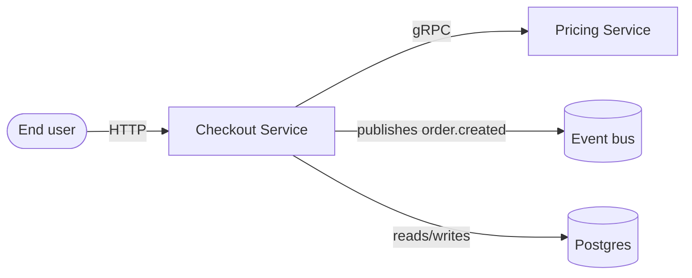
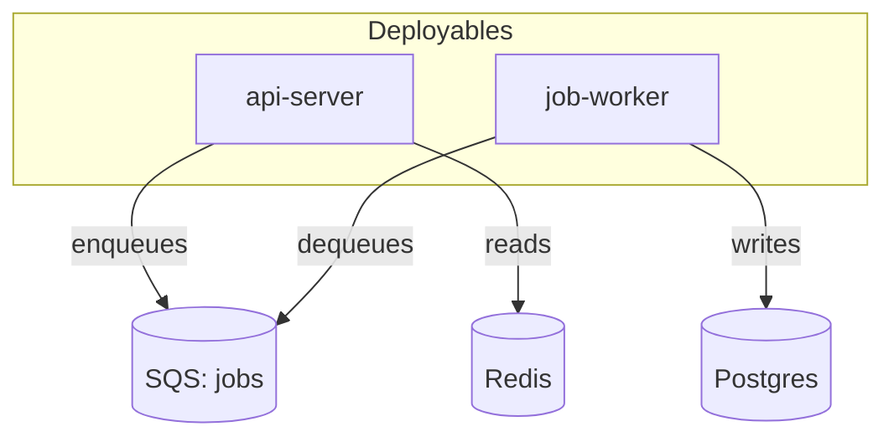
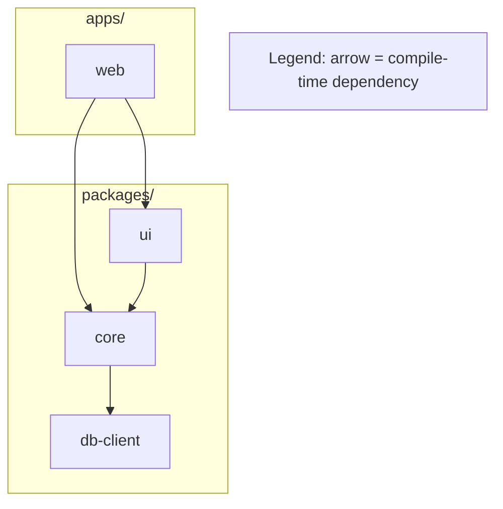
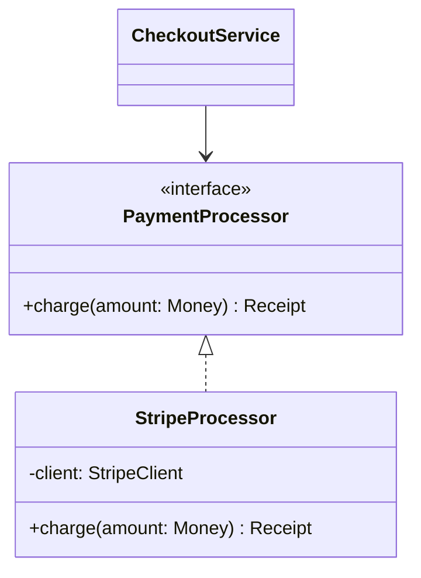
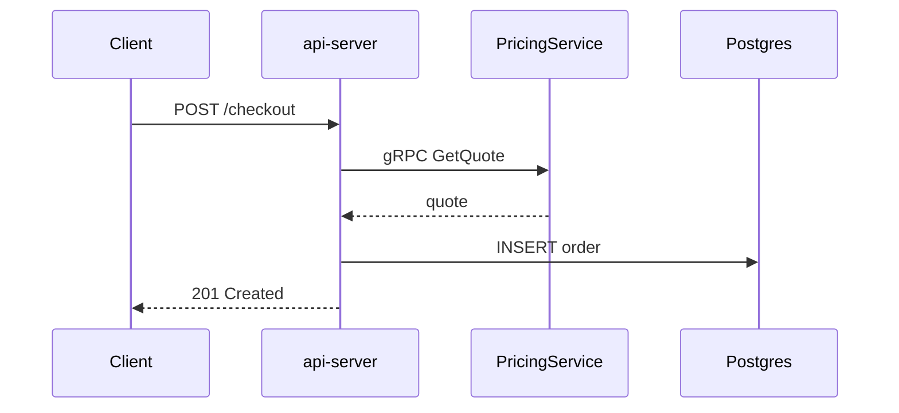

# View catalog

Candidate views for a codebase, each with the question it answers and a Mermaid
skeleton. Pick the minimal set that covers understanding (typically 3–5) — this
is a menu, not a checklist. The Miro MCP's own Mermaid instructions
(`diagram_get_mermaid_instructions`) override any syntax here.

Common defaults for an unfamiliar service: **System context → Module
decomposition → One key request sequence**, plus an ERD if it owns persistent
state.

Skeletons below omit `click` lines for brevity except where shown. Per R10, no
skeleton ever puts a repo path in a label — attach GitHub permalinks with
`click` in `flowchart` and `classDiagram`; `sequenceDiagram` and `erDiagram`
keep their anchors in the companion doc.

---

## V1 — System context

*Question:* what is this system, and what does it talk to?
*Notation:* flowchart. Edges = runtime integrations, labelled by protocol.



Keep it to the system plus its immediate neighbours. No internals.

---

## V2 — Runtime architecture

*Question:* what actually runs, and how do the pieces communicate at runtime?
*Notation:* flowchart. Edges = calls / publishes / reads / writes.



Use `subgraph` for deployment/ownership boundaries. No class internals (H2).

---

## V3 — Module decomposition / dependency graph

*Question:* how is the code organised, and which way do dependencies point?
*Notation:* flowchart, **unlabelled** edges + legend (R9).



Containment via `subgraph` only. Label an edge only when it adds object-level
meaning ("imports types"). No runtime calls here. The module nodes are named
after the package, not its path — the path is the tooltip on the `click` link.

---

## V4 — Domain model / persistence

*Question:* what persistent entities exist and how do they relate?
*Notation:* ERD. Only tables/persisted models — never request DTOs.

```mermaid
erDiagram
  USER ||--o{ ORDER : places
  ORDER ||--|{ ORDER_ITEM : contains
  USER {
    uuid id PK
    string email UQ
    timestamp created_at
  }
  ORDER {
    uuid id PK
    uuid user_id FK
    string status
  }
```

PK/FK/UQ plus 2–4 distinguishing fields per entity; note what you omitted.
Entity names are table/model names, not migration or schema file paths; ERDs
take no `click` bindings, so link the schema from the companion doc.

---

## V5 — Static structure / key types

*Question:* how are the core types related — inheritance, composition, ports?
*Notation:* UML class. Real classes/interfaces only, with evidenced relations.



Show only members that carry the diagram's point. Never model packages or
services as classes. Class diagrams use `click <Class> href "<url>" "<tooltip>"`
— note the `href` keyword, which flowcharts do not require.

---

## V6 — Request / interaction sequence

*Question:* what happens, in order, when *one concrete scenario* runs?
*Notation:* UML sequence. One scenario per diagram.



Name the scenario in the title. Error paths only if they are the point.
Participants are named after the actor, never a handler file path; Mermaid 10.3
cannot bind links here, so the anchors go in the companion doc.

---

## V7 — Algorithm / control flow

*Question:* how does this one non-obvious piece of logic decide what to do?
*Notation:* flowchart with decision nodes.

```mermaid
flowchart TB
  start([retry attempt]) --> chk{attempts < max?}
  chk -->|no| fail([dead-letter])
  chk -->|yes| delay[wait backoff 2^n]
  delay --> call[re-invoke handler]
  call --> ok{success?}
  ok -->|yes| done([ack])
  ok -->|no| chk
```

Use only where the logic is genuinely worth drawing — not for every function.
